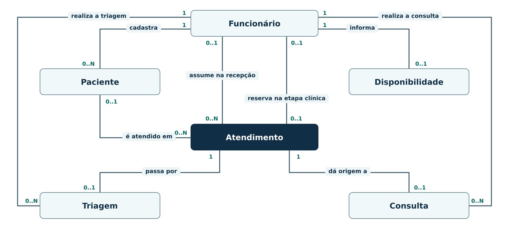
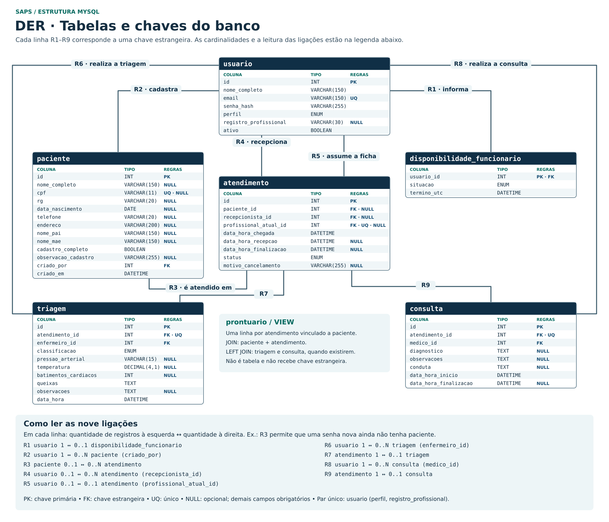

# Modelagem do banco · SAPS

**Imagens em PNG:** [MER](MER.png) · [DER](DER.png). Abra a imagem no GitHub e use o botão de download para salvar no computador.

O **MER** explica as regras do projeto: quem cadastra, atende, classifica ou consulta. O **DER** traduz essas relações para as seis tabelas e nove chaves estrangeiras de [database/script.sql](../script.sql). A visão `prontuario` aparece à parte porque lê registros existentes. As cardinalidades representam o banco ao longo do tempo: um atendimento recém-criado ainda pode estar sem paciente, triagem ou consulta.

## Da senha ao prontuário

| Etapa | O que o SAPS grava |
| --- | --- |
| 1. Gerar senha | A recepção cria um `atendimento` em `aguardando_recepcao`. O ID 1 aparece como **AT0001**. Ainda não há paciente nem recepcionista vinculados. |
| 2. Chamar e identificar | A chamada muda a situação para `em_recepcao` e registra o recepcionista. Ele localiza um paciente ou cria um cadastro, inclusive provisório. Ao encaminhar, o atendimento fica com `paciente_id` preenchido e passa a `aguardando_triagem`. |
| 3. Fazer a triagem | Ao assumir, o enfermeiro reserva a ficha em `profissional_atual_id` e o estado passa a `em_triagem`. Ao concluir, grava a `triagem` com a classificação de Manchester, libera a reserva e encaminha para `aguardando_medico`. |
| 4. Fazer a consulta | A fila médica considera a classificação; em empate, chegada e ID. Ao assumir, o médico reserva a ficha, abre a `consulta` e o estado passa a `em_atendimento`. A triagem é lida pelo mesmo `atendimento_id`. |
| 5. Finalizar | O médico confirma a avaliação. Pode registrar receita, atestado, exame, medicação ou orientação como texto em `consulta.conduta`, ou deixá-la vazia. O sistema grava a finalização da consulta e do atendimento na mesma transação e libera o profissional. |
| Cancelar antes da finalização | A recepção confirma o cancelamento e informa o motivo. O atendimento passa a `cancelado`; a reserva é liberada e os registros são preservados. Um atendimento confirmado pelo médico ou já encerrado não pode ser cancelado. |

**O prontuário não é uma etapa que gera outra ficha.** A visão faz um `JOIN` de paciente com atendimento e um `LEFT JOIN` com triagem e consulta. Logo, uma senha sem paciente ainda não aparece no prontuário. Depois do vínculo, o atendimento já aparece mesmo que ainda não haja dados clínicos. A tela médica filtra os atendimentos finalizados ao consultar o histórico.

**Papéis e limites:** recepcionista, enfermeiro e médico são perfis de `usuario`. O SQL exige registro profissional para enfermeiro e médico, e nulo para a recepção. É o backend que verifica o perfil em cada ação. A unicidade de `profissional_atual_id` permite no máximo uma reserva clínica por profissional; as colunas únicas `triagem.atendimento_id` e `consulta.atendimento_id` permitem no máximo uma triagem e uma consulta por atendimento. A disponibilidade do funcionário é independente da reserva: guarda a situação informada e seu término, não um histórico de escalas.

**Regras do cadastro e da ficha:** no banco, CPF é opcional e único quando informado; para marcar um cadastro como completo, são exigidos nome e nascimento. A tabela permite sinais vitais nulos; a rota de conclusão da triagem exige pressão, temperatura e batimentos. A consulta pode começar sem diagnóstico, mas o backend exige a avaliação para finalizá-la.

Implementação: [recepção](../../backend/recepcao.js), [etapas clínicas](../../backend/rotas/fluxo-clinico.js) e [fila médica](../../backend/rotas/medico.js).
